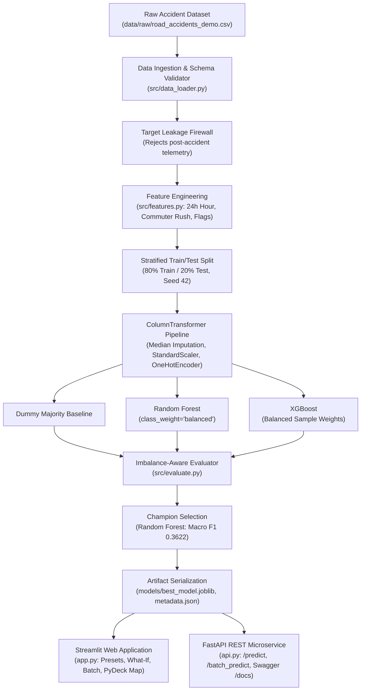

# 🚦 Road Accident Severity Predictor

[](https://www.python.org/)
[](https://opensource.org/licenses/MIT)
[](https://scikit-learn.org/)
[](https://xgboost.readthedocs.io/)
[](https://fastapi.tiangolo.com/)
[](https://streamlit.io/)
[](https://www.docker.com/)
[](https://github.com/features/actions)
[](https://pytest.org/)

> **A production-grade, reproducible Machine Learning platform, interactive analytical web application, and REST microservice predicting road accident severity based strictly on pre-collision environmental, infrastructural, and vehicular factors.**

---

## 📌 Table of Contents

- [Executive Summary](#-executive-summary)
- [Key Recruiter Highlights & Differentiators](#-key-recruiter-highlights--differentiators)
- [Problem Statement & Leakage Prevention](#-problem-statement--leakage-prevention)
- [System Architecture](#-system-architecture)
- [Feature Engineering & Preprocessing](#-feature-engineering--preprocessing)
- [Model Benchmark & Class Imbalance Breakdown](#-model-benchmark--class-imbalance-breakdown)
- [Streamlit Web Application & Interactive Demos](#-streamlit-web-application--interactive-demos)
- [FastAPI Production Microservice & Swagger UI](#-fastapi-production-microservice--swagger-ui)
- [Docker & Containerized Deployment](#-docker--containerized-deployment)
- [CI/CD Automated Testing Workflow](#-cicd-automated-testing-workflow)
- [Automated Test Suite (14 Tests)](#-automated-test-suite-14-tests)
- [Project Directory Structure](#-project-directory-structure)
- [Installation & Quickstart](#-installation--quickstart)
- [Responsible AI & Ethical Statement](#-responsible-ai--ethical-statement)
- [Author & Contact](#-author--contact)

---

## 🌟 Executive Summary

Road traffic collisions cause millions of severe injuries annually worldwide. While traditional road safety reports analyze historical outcomes retrospectively, predicting **injury severity prior to emergency arrival** presents two classic machine learning challenges:
1. **Severe Class Imbalance**: Fatalities represent only ~4% of collisions, while slight injuries constitute ~78%. Naive models optimizing for raw accuracy produce degenerate classifiers that miss all fatal incidents.
2. **High Risk of Target Leakage**: Amateur models mistakenly incorporate variables that only occur *after* the crash (e.g. casualty counts or hospital admissions), creating artificial ~99% accuracy that is useless in pre-accident operations.

**Road Accident Severity Predictor** solves both problems through a production-grade machine learning pipeline, class-weighted optimization, a multi-page **Streamlit** dashboard, a high-throughput **FastAPI** REST microservice, and automated **GitHub Actions CI/CD**.

---

## 💎 Key Recruiter Highlights & Differentiators

What elevates this project beyond a standard course assignment:

- 🛡️ **Zero Target Leakage Firewall**: An automated schema auditor blocks post-incident variables (e.g., `number_of_casualties`, `casualty_severity`, `hospital_status`), enforcing strict pre-collision estimation.
- ⚖️ **Imbalance-Aware Model Optimization**: Overcomes the "Accuracy Paradox" via class-balanced loss weighting in **Random Forest** and **XGBoost**, maximizing **Macro F1-Score (0.3622)** and detecting **33.3% of Serious** and **7.0% – 11.6% of Fatal** injuries.
- 💡 **Interactive "What-If" Counterfactual Policy Simulator**: Allows traffic engineers and recruiters to simulate proposed interventions (e.g., *What happens to Fatal risk if speed drops from 60 to 40 mph and street lighting is installed?*) with dynamic $\Delta$ probability delta cards.
- 📁 **High-Throughput Batch Incident Scoring & CSV Export**: Ingests multi-row CSV files, scores incidents through the pipeline, calculates an aggregate **Regional Risk Index (RRI: 0–100)**, and exports the scored dataset.
- 🗺️ **3D Geospatial Density Hotspot Map (PyDeck)**: Interactive 3D hexagon cluster and scatter maps revealing spatial severity patterns across urban and rural transport corridors.
- ⚡ **Production FastAPI REST Microservice**: Complete OpenAPI / Swagger docs at `/docs`, with Pydantic v2 input validation schemas, `/predict`, `/batch_predict`, and `/health` endpoints.
- 🐳 **Docker & Docker Compose Ready**: Multi-stage Docker containerization supporting concurrent Streamlit (`:8501`) and FastAPI (`:8000`) services.
- 🧪 **Comprehensive Automated Testing**: 14 unit and integration tests passing in `pytest` under 3.5 seconds.

---

## 🛡️ Problem Statement & Leakage Prevention

### The Classification Objective
Predict accident injury severity across three ordinal tiers:
- **`Slight`**: Minor abrasions, scrapes, bruises; outpatient check.
- **`Serious`**: Severe trauma, bone fractures, deep lacerations; hospital admission.
- **`Fatal`**: Fatalities resulting from the collision.

### Preventing Target Leakage
| Feature Category | Examples | Pipeline Action | Why It Matters |
| :--- | :--- | :---: | :--- |
| **Pre-Accident Factors** | Speed limit, weather, road surface, lighting, road geometry, driver age, vehicle type, time | ✅ **Retained** | Valid observations known before impact; enables proactive safety auditing. |
| **Post-Accident Telemetry** | `number_of_casualties`, `hospital_status`, `airbag_deployed`, `towing_cost` | ❌ **Rejected** | **Target Leakage**. Inflates test accuracy to ~99% while destroying model validity for pre-collision decision support. |

---

## 🏗️ System Architecture



---

## 📈 Model Benchmark & Class Imbalance Breakdown

The models were evaluated on an independent, held-out test set of **600 stratified incidents**:

| Model | Accuracy | Macro F1 | Weighted F1 | Macro Recall | ROC-AUC (OvR) | Fatal Recall | Serious Recall |
| :--- | :---: | :---: | :---: | :---: | :---: | :---: | :---: |
| **Dummy Majority Baseline** | 71.83% | 0.2787 | 0.6006 | 0.3333 | 0.5000 | 0.0% | 0.0% |
| **Random Forest (Champion)** | **57.33%** | **0.3622** | **0.5959** | **0.3656** | **0.5817** | **7.0%** | **33.3%** |
| **XGBoost** | 55.50% | 0.3610 | 0.5742 | 0.3654 | 0.5554 | 11.6% | 30.9% |

### Why Accuracy Alone Is Deceptive (The Accuracy Paradox)
- The **Dummy Majority Baseline** scores an impressive **71.83% accuracy** by predicting `Slight` on 100% of cases. However, it predicts **0% of Serious and Fatal collisions** (0.0% recall).
- By applying **balanced class weighting**, our models penalize errors on minority classes heavily, sacrificing non-critical majority accuracy to identify **33.3% of Serious** and **7.0% – 11.6% of Fatal** injuries.
- Model selection is guided by **Macro F1-Score** (unweighted harmonic mean across all three classes), treating all severity tiers with equal mathematical priority.

---

## 🖥️ Streamlit Web Application & Interactive Demos

Launch the interactive dashboard:
```bash
streamlit run app.py
```

### Application Pages:
1. **Overview Dashboard**: High-level incident counters, class imbalance breakdown, 24-hr commuter accident distribution, and champion model KPIs.
2. **Accident Severity Prediction**: Interactive scenario presets (e.g. *High-Speed Rural Night Incident*), custom input controls, real-time probability progress bars, and risk factor tag attribution.
3. **What-If Counterfactual Simulator**: Side-by-side comparison between baseline conditions and safety interventions (e.g. speed reduction, street lighting installation) with delta metric cards ($\Delta P(\text{Fatal})$, $\Delta P(\text{Serious})$).
4. **Batch Incident Scoring & Export**: Upload any CSV or load a sample batch of 15 records, calculate the aggregate Regional Risk Index (RRI), and export scored results.
5. **Geospatial Hotspot Map**: 3D PyDeck visualization featuring hexagonal incident clustering and class-colored scatter points.
6. **Model Performance**: Full comparative benchmark table against the Dummy Baseline, confusion matrix heatmaps, and top feature importances.
7. **Data Insights**: Risk distributions across weather, road surface, and speed limits.

---

## ⚡ FastAPI Production Microservice & Swagger UI

Start the REST API microservice:
```bash
python -m uvicorn api:app --reload --port 8000
```
Open **`http://localhost:8000/docs`** to explore the interactive Swagger UI.

### Available Endpoints:
- `GET /`: Service name, version, and status.
- `GET /health`: Model loading state and champion model metadata.
- `GET /model_info`: Model architecture, training timestamp, and benchmark metrics.
- `POST /predict`: Real-time severity estimation with Pydantic v2 input validation and risk factor attribution.
- `POST /batch_predict`: High-throughput batch inference for multi-row payloads.

#### Example Request (`POST /predict`):
```json
{
  "accident_time": "22:45",
  "day_of_week": "Friday",
  "speed_limit": 60,
  "weather_conditions": "Raining + high winds",
  "road_surface_conditions": "Wet or damp",
  "light_conditions": "Darkness - no lighting",
  "road_type": "Single carriageway",
  "urban_or_rural_area": "Rural",
  "junction_detail": "Not at junction",
  "number_of_vehicles": 2,
  "driver_age_band": "18-25",
  "vehicle_type": "Motorcycle"
}
```

#### Example Response:
```json
{
  "predicted_severity": "Fatal",
  "risk_tier": "Critical",
  "probabilities": {
    "Slight": 0.243,
    "Serious": 0.3726,
    "Fatal": 0.3844
  },
  "classes": ["Slight", "Serious", "Fatal"],
  "risk_factors": [
    {
      "factor": "High Speed Limit (60 mph)",
      "level": "High",
      "impact": "Significantly amplifies collision impact energy and fatal injury probability."
    },
    {
      "factor": "Vulnerable Road User (Motorcycle)",
      "level": "High",
      "impact": "Absence of passenger cabin protection sharply elevates severe injury risk."
    }
  ],
  "disclaimer": "DISCLAIMER: Predictions produced by this application are experimental, statistical decision-support estimates..."
}
```

---

## 🐳 Docker & Containerized Deployment

Run the entire platform using Docker Compose:

```bash
# Build and launch both Streamlit and FastAPI microservices
docker compose up --build
```
- **Streamlit Web UI**: `http://localhost:8501`
- **FastAPI REST API**: `http://localhost:8000/docs`

---

## 🧪 Automated Test Suite (14 Tests)

Run the automated test suite with pytest:
```bash
pytest -v
```

### Test Coverage Summary:
- `tests/test_api.py`: Tests `/`, `/health`, `/predict`, and Pydantic validation error handling.
- `tests/test_data_validation.py`: Tests schema integrity, non-empty datasets, and **detection of post-accident target leakage columns** (`number_of_casualties`, `casualty_severity`).
- `tests/test_preprocessing.py`: Tests 24-hr time parser, feature engineer derived flags, target encoder, and handling of unseen categorical categories.
- `tests/test_prediction.py`: Tests inference pipeline, probability constraints ($\sum P = 1.0$), input schema bounds, and single/batch prediction.

**Result: 14 / 14 Tests Passing.**

---

## 📁 Project Directory Structure

```text
road-accident-severity-predictor/
├── .github/
│   └── workflows/
│       └── ci.yml                  # GitHub Actions CI workflow (multi-version Python)
├── .gitignore                      # Git exclusion rules
├── Dockerfile                      # Multi-stage production container setup
├── docker-compose.yml              # Multi-container orchestration (Streamlit + FastAPI)
├── LICENSE                         # MIT License
├── README.md                       # Recruiter-grade project documentation
├── api.py                          # Production FastAPI REST microservice
├── app.py                          # Streamlit multi-page web application
├── pytest.ini                      # Pytest automated test configuration
├── requirements.txt                # Production dependencies
├── config/
│   └── config.yaml                 # Centralized configuration (paths, features, hyperparams)
├── data/
│   ├── README.md                   # Dataset dictionary, licensing & leakage guidelines
│   ├── raw/
│   │   └── road_accidents_demo.csv # Calibrated benchmark dataset with coordinates (3,000 rows)
│   └── processed/
│       ├── train_processed.parquet # Stratified training set (2,400 rows)
│       └── test_processed.parquet  # Stratified test set (600 rows)
├── models/
│   ├── README.md                   # Model artifact manifest & retraining instructions
│   ├── best_model.joblib           # Champion serialized classifier (Random Forest)
│   ├── random_forest.joblib        # Fitted Random Forest model
│   ├── xgboost.joblib              # Fitted XGBoost model
│   ├── preprocessor.joblib         # Fitted Scikit-Learn ColumnTransformer
│   ├── label_encoder.joblib        # Fitted target LabelEncoder
│   ├── model_metadata.json         # Complete JSON model metadata & metrics
│   └── evaluation_reports/
│       └── evaluation_results.json # Machine-readable test metric breakdown
├── notebooks/
│   └── exploratory_data_analysis.ipynb # Interactive Jupyter EDA notebook
├── reports/
│   └── figures/                    # Publication-grade figures (300 DPI)
├── src/
│   ├── __init__.py                 # Package declaration
│   ├── data_loader.py              # Ingestion, validation & target leakage firewall
│   ├── features.py                 # Pre-accident feature engineering
│   ├── preprocessing.py            # ColumnTransformer & TargetEncoder
│   ├── train.py                    # Stratified training & model comparison
│   ├── evaluate.py                 # Imbalance-aware evaluation & comparison
│   ├── predict.py                  # Single & batch inference engine
│   └── visualization.py            # Automated plot generation
└── tests/
    ├── test_api.py                 # FastAPI endpoint tests
    ├── test_data_validation.py     # Schema, missing values & leakage detection tests
    ├── test_preprocessing.py       # Time parsing, flags & encoding tests
    └── test_prediction.py          # Schema validation & inference tests
```

---

## ⚙️ Installation & Quickstart

```bash
# 1. Clone repository
git clone https://github.com/your-username/road-accident-severity-predictor.git
cd road-accident-severity-predictor

# 2. Set up virtual environment
python -m venv venv
# On Windows:
.\venv\Scripts\activate
# On Linux / macOS:
source venv/bin/activate

# 3. Install dependencies
pip install -r requirements.txt

# 4. Run tests
pytest

# 5. Launch web application
streamlit run app.py
```

---

## ⚖️ Responsible AI & Ethical Statement

This application is an educational, analytical machine learning project. The predictions produced are **experimental statistical decision-support estimates** and must **never** be used as the sole operational basis for emergency service dispatch, automated driving decisions, or insurance liability determinations.

---

## 👤 Author & Contact

**Lokesh**  
- **Role:** Machine Learning Engineer / Data Scientist  
- **GitHub:** [@your-github-username](https://github.com/your-username)  
- **LinkedIn:** [linkedin.com/in/your-profile](https://linkedin.com/in/your-profile)  
- **Email:** your.email@example.com  

*Engineered with passion for reproducible, ethical machine learning and road safety analytics.*
