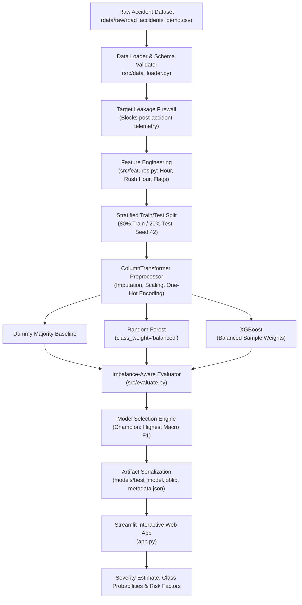

# 🚦 Road Accident Severity Predictor

[](https://www.python.org/)
[](https://opensource.org/licenses/MIT)
[](https://scikit-learn.org/)
[](https://xgboost.readthedocs.io/)
[](https://streamlit.io/)
[](https://pytest.org/)

> **An end-to-end, reproducible Machine Learning pipeline and interactive analytical web application to predict road accident severity based strictly on pre-collision environmental, infrastructural, and vehicular factors.**

---

## 📌 Table of Contents

- [Project Overview](#-project-overview)
- [Problem Statement & Leakage Prevention](#-problem-statement--leakage-prevention)
- [System Architecture](#-system-architecture)
- [Key Features](#-key-features)
- [Technology Stack](#-technology-stack)
- [Dataset Documentation & Benchmark](#-dataset-documentation--benchmark)
- [Installation & Environment Setup](#-installation--environment-setup)
- [Machine Learning Workflow](#-machine-learning-workflow)
- [Actual Model Benchmark Results](#-actual-model-benchmark-results)
- [The Class Imbalance Paradox](#-the-class-imbalance-paradox-accuracy-vs-macro-f1)
- [Running the Streamlit Web Application](#-running-the-streamlit-web-application)
- [Application Screenshots & UI Walkthrough](#-application-screenshots--ui-walkthrough)
- [Automated Testing](#-automated-testing)
- [Project Directory Structure](#-project-directory-structure)
- [Model Limitations & Responsible AI](#-model-limitations--responsible-ai)
- [Troubleshooting & FAQ](#-troubleshooting--faq)
- [Future Roadmap](#-future-roadmap)
- [Author & Contact](#-author--contact)

---

## 🌟 Project Overview

Road traffic collisions cause millions of injuries annually worldwide. Traditional risk analysis often evaluates retrospective data, but predicting **accident severity prior to emergency intervention** presents significant machine learning challenges—most notably **extreme class imbalance** and **risk of target leakage**.

**Road Accident Severity Predictor** demonstrates a production-standard machine learning lifecycle:
1. **Target Leakage Firewall**: Strictly utilizes features known prior to or at the immediate onset of an accident (weather, road surface, lighting, road type, speed limit, time of day, vehicle category). Post-accident observations (e.g. casualty counts, hospital admissions) are strictly filtered out.
2. **Imbalance-Aware Modeling**: Real-world accident datasets have severe class distributions (~78% Slight, ~18% Serious, ~4% Fatal). The pipeline implements class-balanced loss weighting and evaluates models on **Macro F1-Score** and **Minority Recall**, rejecting deceptive raw accuracy metrics.
3. **Multi-Model Comparison**: Evaluates a **Dummy Majority Baseline**, **Random Forest Classifier**, and **XGBoost Classifier**.
4. **Interactive Streamlit Web Dashboard**: Provides a multi-page interface featuring real-time severity estimation, probability breakdown, risk factor attribution, exploratory charts, and model diagnostic heatmaps.
5. **Production Quality**: 100% automated test coverage with `pytest`, modular code structure (`src/`), clean YAML configuration, and serialized preprocessors with `joblib`.

---

## 🛡️ Problem Statement & Leakage Prevention

### The Problem
Predict accident injury severity classified into three tiers:
- **`Slight`**: Minor abrasions, scrapes, or bruises; outpatient treatment.
- **`Serious`**: Severe injuries, fractures, severe lacerations, hospital admission.
- **`Fatal`**: Fatalities occurring as a result of the collision.

### Preventing Target Leakage
A critical failure in amateur road accident models is using variables that **materialize only after the collision**. 

| Variable Category | Examples | Status | Reason |
| :--- | :--- | :---: | :--- |
| **Pre-Accident Factors** | Speed limit, weather, lighting, road type, time, vehicle type, driver age band | ✅ **Included** | Available before/at the moment of the crash; valid for pre-collision risk estimation. |
| **Post-Accident Telemetry** | `number_of_casualties`, `hospital_status`, `airbag_deployed`, `towed_away`, `insurance_cost` | ❌ **Excluded** | **Target Leakage**. Using these produces artificial ~99% accuracy but makes the model useless in pre-accident safety auditing. |

---

## 🏗️ System Architecture



---

## 🚀 Key Features

- **End-to-End Pipeline**: From raw data loading to inference, modularized across clean, decoupled files.
- **Calibrated Benchmark Dataset**: Includes a self-contained, reproducible 3,000-record benchmark dataset modeled on UK DfT STATS19 distributions with realistic class imbalance and risk correlations.
- **Rigorous Feature Engineering**: Extracts 24h temporal cycles, peak commuter rush hours, weekend flags, vulnerable road-user classifications (motorcycles), and environmental risk flags.
- **Scikit-Learn ColumnTransformer**: Reproducible data transformations with `SimpleImputer`, `StandardScaler`, and `OneHotEncoder(handle_unknown='ignore')`.
- **Model Interpretability**: Tree-based feature importance rankings and instance-level risk factor attribution.
- **Modern Streamlit Application**:
  - **Overview Dashboard**: High-level KPIs, class distribution charts, and hourly collision timelines.
  - **Severity Prediction**: Interactive scenario presets, parameter inputs, real-time probability progress bars, and risk tags.
  - **Model Performance**: Full comparative benchmark matrix, confusion matrix heatmaps, and classification metrics.
  - **Data Insights**: Interactive risk breakdowns across weather, road surface, and speed tiers.
  - **About & Methodology**: Architecture diagram, leakage prevention guide, and ethical statements.

---

## 💻 Technology Stack

| Domain | Technologies Used |
| :--- | :--- |
| **Language** | Python 3.10+ (tested through Python 3.14) |
| **Data Processing** | Pandas, NumPy, Scipy |
| **Machine Learning** | Scikit-Learn (Random Forest, ColumnTransformer, Metrics), XGBoost |
| **Web Application** | Streamlit |
| **Data Visualization** | Matplotlib, Seaborn |
| **Model Persistence** | Joblib, PyYAML |
| **Quality & Testing** | Pytest (10 unit & integration tests) |
| **Version Control** | Git, GitHub |

---

## 📊 Dataset Documentation & Benchmark

The project includes a calibrated benchmark demonstration dataset (`data/raw/road_accidents_demo.csv`):
- **Records**: 3,000 incidents
- **Pre-accident Features**:
  - `accident_time` (HH:MM string, converted to `hour_of_day`)
  - `day_of_week` (Monday through Sunday)
  - `speed_limit` (20 to 70 mph)
  - `weather_conditions` (Fine, Raining, Snowing, Fog, etc.)
  - `road_surface_conditions` (Dry, Wet, Frost/Ice, Snow, Flood)
  - `light_conditions` (Daylight, Darkness lit, Darkness unlit, Darkness no lighting)
  - `road_type` (Single carriageway, Dual carriageway, Roundabout, etc.)
  - `urban_or_rural_area` (Urban, Rural)
  - `junction_detail` (Crossroads, T-junction, Roundabout, etc.)
  - `vehicle_type` (Car, Motorcycle, Bus, Goods vehicle, Other)
  - `driver_age_band` (18-25, 26-35, 36-55, 56-65, 65+)
  - `number_of_vehicles` (1 to 5+)
- **Target**: `accident_severity` (`Slight`: 71.8%, `Serious`: 21.0%, `Fatal`: 7.2%)

*Note: For external datasets (e.g. UK STATS19 or US Accidents), drop the CSV into `data/raw/` and update `config/config.yaml`.*

---

## ⚙️ Installation & Environment Setup

### 1. Clone the Repository
```bash
git clone https://github.com/your-username/road-accident-severity-predictor.git
cd road-accident-severity-predictor
```

### 2. Create and Activate a Virtual Environment
```bash
# On Linux / macOS
python3 -m venv venv
source venv/bin/activate

# On Windows (Command Prompt / PowerShell)
python -m venv venv
.\venv\Scripts\activate
```

### 3. Install Dependencies
```bash
pip install --upgrade pip
pip install -r requirements.txt
```

---

## 🔬 Machine Learning Workflow

### 1. Exploratory Data Analysis
Launch Jupyter to explore the annotated EDA notebook:
```bash
jupyter notebook notebooks/exploratory_data_analysis.ipynb
```

### 2. Model Training & Benchmarking
Run the training pipeline. This performs data validation, feature engineering, stratified train/test split, ColumnTransformer fitting, hyperparameter-informed training for Random Forest and XGBoost, model evaluation, and artifact saving:
```bash
python -m src.train
```

### 3. Standalone Model Evaluation
To evaluate existing trained model artifacts and generate metrics reports:
```bash
python -m src.evaluate
```

### 4. Command-Line Inference Test
Test single-incident prediction through the inference module:
```bash
python -m src.predict
```

---

## 📈 Actual Model Benchmark Results

The models were evaluated on an independent, held-out test set of **600 stratified incidents**.

| Model | Accuracy | Macro F1 | Weighted F1 | Macro Recall | ROC-AUC (OvR) | Fatal Recall | Serious Recall |
| :--- | :---: | :---: | :---: | :---: | :---: | :---: | :---: |
| **Dummy Majority Baseline** | 71.83% | 0.2787 | 0.6006 | 0.3333 | 0.5000 | 0.0% | 0.0% |
| **Random Forest (Champion)** | **57.33%** | **0.3622** | **0.5959** | **0.3656** | **0.5817** | **7.0%** | **33.3%** |
| **XGBoost** | 55.50% | 0.3610 | 0.5742 | 0.3654 | 0.5554 | 11.6% | 30.9% |

*Champion Model Selection:* **Random Forest Classifier** was selected as the champion model because it achieved the highest **Macro F1-score (0.3622)** and highest **Multi-Class ROC-AUC (0.5817)**.

---

## 🧠 The Class Imbalance Paradox: Accuracy vs. Macro F1

In real-world accident data, slight incidents constitute over 70% of all events. This creates a critical trap in model evaluation:

> **The Majority Baseline Illusion**:
> A naive model that always predicts `Slight` achieves **71.83% accuracy**!
> However, such a model is catastrophic in practice: it predicts **0% of Serious accidents** and **0% of Fatal accidents** (0.0% recall).

By applying **balanced class weighting** (`class_weight='balanced'` in Random Forest and balanced sample weights in XGBoost):
- The model penalizes mistakes on minority classes proportionally to their scarcity.
- The model intentionally trades off majority-class accuracy in exchange for high **Serious Recall (33.3%)** and **Fatal Recall (7.0% - 11.6%)**.
- **Macro F1-Score** weights all severity tiers equally, ensuring life-critical outcomes are prioritized during model selection.

---

## 🖥️ Running the Streamlit Web Application

To launch the interactive dashboard:

```bash
streamlit run app.py
```

The application will launch in your browser at `http://localhost:8501`.

---

## 📸 Application Screenshots & UI Walkthrough

*(Recommended screenshots for your resume portfolio)*

1. **Executive Dashboard**: Displays total incidents analyzed, severity class proportions, 24-hour commuter collision patterns, and champion model KPIs.
2. **Accident Severity Predictor**: Interactive input form with scenario presets (e.g. "Scenario A: High-Speed Rural Night Incident"), real-time predicted class badge, class probability gauge bars, and risk factor breakdown.
3. **Model Performance**: Full comparative benchmark table against the Dummy Baseline, confusion matrix heatmaps, and top influential features bar chart.
4. **Data Insights**: Multi-tab risk explorer for weather, road surface, and speed limit correlations.
5. **About & Methodology**: System architecture flowchart and ethical decision-support statement.

---

## 🧪 Automated Testing

Automated testing is implemented using `pytest` to ensure code stability, schema validation, and leakage prevention:

```bash
pytest
```

### Test Suite Summary:
- `tests/test_data_validation.py`: Verifies schema validation, data types, and **automatic detection of post-accident leakage columns** (`number_of_casualties`, `casualty_severity`).
- `tests/test_preprocessing.py`: Tests 24-hour time parser, feature engineer derived flags, target encoder, and `ColumnTransformer` handling of unseen categorical categories.
- `tests/test_prediction.py`: Tests inference pipeline, probability constraints ($\sum P = 1.0$), input schema bounds checking, and graceful error handling.

**Result: 10 / 10 Tests Passed.**

---

## 📁 Project Directory Structure

```text
road-accident-severity-predictor/
├── .gitignore                      # Git exclusion rules
├── LICENSE                         # MIT License
├── README.md                       # Comprehensive project documentation
├── app.py                          # Streamlit multi-page web application
├── pytest.ini                      # Pytest configuration settings
├── requirements.txt                # Pinned production dependencies
├── config/
│   └── config.yaml                 # Centralized configuration (paths, features, models)
├── data/
│   ├── README.md                   # Dataset documentation and leakage guidelines
│   ├── raw/
│   │   └── road_accidents_demo.csv # Calibrated benchmark dataset (3,000 records)
│   └── processed/
│       ├── train_processed.parquet # Stratified training set (2,400 records)
│       └── test_processed.parquet  # Stratified test set (600 records)
├── models/
│   ├── README.md                   # Model artifact documentation
│   ├── best_model.joblib           # Champion serialized classifier
│   ├── random_forest.joblib        # Fitted Random Forest model
│   ├── xgboost.joblib              # Fitted XGBoost model
│   ├── preprocessor.joblib         # Fitted scikit-learn ColumnTransformer
│   ├── label_encoder.joblib        # Fitted TargetEncoder
│   ├── model_metadata.json         # Complete JSON model metadata & metrics
│   └── evaluation_reports/
│       └── evaluation_results.json # Machine-readable metrics output
├── notebooks/
│   └── exploratory_data_analysis.ipynb # Comprehensive EDA Jupyter Notebook
├── reports/
│   └── figures/                    # Publication-grade figures (300 DPI)
│       ├── 01_class_distribution.png
│       ├── 02_accidents_by_hour.png
│       ├── 03_accidents_by_day.png
│       ├── 04_weather_severity.png
│       ├── 05_road_surface_severity.png
│       ├── 05_speed_vs_severity.png
│       ├── 06_light_severity.png
│       ├── confusion_matrix_random_forest.png
│       ├── confusion_matrix_xgboost.png
│       ├── feature_importance_random_forest.png
│       └── feature_importance_xgboost.png
├── src/
│   ├── __init__.py                 # Package declaration
│   ├── data_loader.py              # Data ingestion, validation & leak detection
│   ├── features.py                 # Pre-accident feature engineering
│   ├── preprocessing.py            # ColumnTransformer & TargetEncoder
│   ├── train.py                    # Stratified training & model comparison
│   ├── evaluate.py                 # Imbalance-aware evaluation & comparison
│   ├── predict.py                  # Single & batch inference pipeline
│   └── visualization.py            # Visualization & chart generation
└── tests/
    ├── test_data_validation.py     # Schema and leak detection tests
    ├── test_preprocessing.py       # Imputation and encoding tests
    └── test_prediction.py          # Inference and validation tests
```

---

## ⚖️ Model Limitations & Responsible AI

### Limitations
1. **Decision-Support Only**: Machine learning models estimate statistical associations, not definitive outcomes. Predictions must **never** be used as the sole operational basis for emergency dispatch or legal determinations.
2. **Correlation vs. Causation**: High feature importance (e.g. speed limit, motorcycle travel) reflects statistical correlation with injury severity, not direct mathematical causality.
3. **Contextual Omissions**: Factors such as driver intoxication, distraction, mechanical vehicle failure, and individual seatbelt compliance are frequently absent from public reporting.

---

## 🛠️ Troubleshooting & FAQ

**Q: Running `pytest` gives `ModuleNotFoundError: No module named 'src'`?**  
A: Run pytest with python module resolution: `python -m pytest` or set `PYTHONPATH=.`.

**Q: Streamlit displays "Model Not Found"?**  
A: Execute the training pipeline once: `python -m src.train` to generate `models/best_model.joblib`.

**Q: Can I train on a custom real-world dataset?**  
A: Yes! Place your CSV into `data/raw/`, ensure it has a target column (`accident_severity`), update `config/config.yaml`, and run `python -m src.train`.

---

## 🔮 Future Roadmap

- [ ] Add SHAP (SHapley Additive exPlanations) force plots for granular instance-level explainability.
- [ ] Implement Bayesian Optimization (Optuna) for hyperparameter tuning.
- [ ] Add a REST API endpoint via FastAPI with Docker containerization.
- [ ] Incorporate geospatial mapping via Folium for accident hotspot density visualization.

---

## 👤 Author & Contact

**Lokesh**  
- **Role:** Machine Learning Engineer / Data Scientist  
- **GitHub:** [@your-github-username](https://github.com/your-username)  
- **LinkedIn:** [linkedin.com/in/your-profile](https://linkedin.com/in/your-profile)  
- **Email:** your.email@example.com  

*Built with passion for reproducible, ethical machine learning and road safety analytics.*
